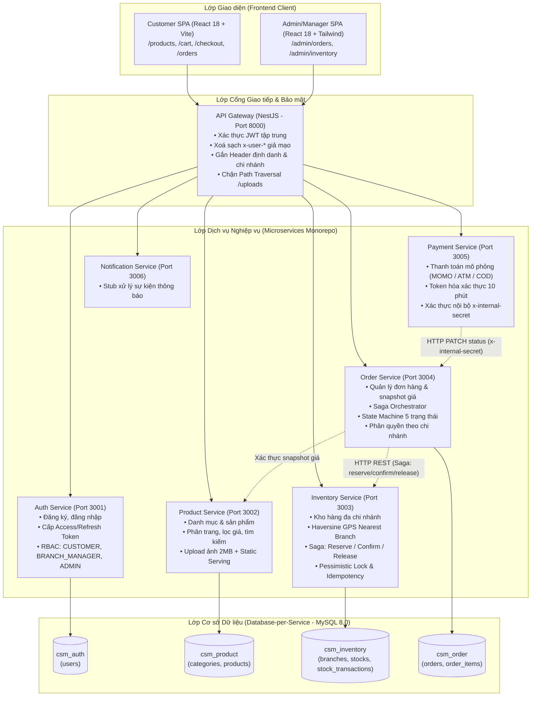

# BÁO CÁO TIẾN ĐỘ ĐỒ ÁN TỐT NGHIỆP: HỆ THỐNG QUẢN LÝ CHUỖI CỬA HÀNG TIỆN LỢI (CSM)

- **Giảng viên hướng dẫn:** ThS. Nguyễn Hữu Trung
- **Nhóm thực hiện:** Nhom04
  - **Hà Trường Giang** (MSSV: ...)
  - **Nguyễn Khánh** (MSSV: ...)
- **Thời lượng báo cáo:** 30 phút (Trình bày: 15 phút, Hỏi đáp: 15 phút)
- **Thời điểm trích xuất dữ liệu:** Phiên làm việc ngày 06/11/2026
- **Quy tắc số liệu:** Toàn bộ số liệu trong báo cáo này được trích xuất trực tiếp từ Git history và các lệnh thực thi thực tế trong phiên làm việc, lưu trữ tại thư mục bằng chứng `logs/evidence/progress_report/`.

---

## PHẦN A. TÓM TẮT DỰ ÁN (1 TRANG)

### 1. Bài toán nghiệp vụ
Hệ thống CSM (Convenience Store Management) giải quyết bài toán vận hành chuỗi cửa hàng tiện lợi đa chi nhánh trong môi trường bán lẻ hiện đại (O2O - Online to Offline):
- Khách hàng xem hàng, chọn chi nhánh mua gần nhất (tính khoảng cách GPS theo công thức Haversine), đặt hàng trực tuyến và nhận hàng tại cửa hàng hoặc giao hàng tận nơi.
- Quản lý tồn kho theo thời gian thực tại từng chi nhánh riêng biệt, chống bán vượt tồn kho (overselling) khi có nhiều khách hàng mua đồng thời cùng một sản phẩm.
- Xử lý giao dịch phân tán giữa dịch vụ Đơn hàng và Kho hàng, đảm bảo tính nhất quán dữ liệu mà không làm nghẽn hệ thống.
- Phân quyền nghiêm ngặt theo mô hình đa chi nhánh: Quản lý chi nhánh (Branch Manager) chỉ được xem và xử lý đơn hàng/kho hàng thuộc chi nhánh mình phụ trách; Quản trị viên (Admin) quản lý toàn chuỗi.

### 2. Sơ đồ Kiến trúc Hệ thống

### 3. Công nghệ sử dụng
- **Backend:** NestJS 10, TypeScript 5.1, TypeORM 0.3, MySQL 8.0, JWT (`@nestjs/jwt`), Multer, Axios.
- **Frontend:** React 18, Vite 5.4, TypeScript 5.5, Tailwind CSS 3.4, TanStack Query v5, Zustand, Framer Motion, Recharts, Lucide Icons.
- **Kiểm thử & CI/CD:** Jest 30 (Unit tests), Playwright 1.64 (E2E browser tests), Node.js E2E Test Suite (HTTP integration), Docker & Docker Compose.

---

## PHẦN B. BẢNG TIẾN ĐỘ CHI TIẾT THEO MODULE

*Ghi chú: Toàn bộ bằng chứng commit và file log đối chiếu trực tiếp từ thư mục `logs/evidence/progress_report/`.*

| STT | Phân hệ / Module | Nội dung đã thực hiện | Trạng thái | Bằng chứng (Commit / Log file) |
| :--- | :--- | :--- | :---: | :--- |
| 1 | **Xác thực & Phân quyền (Auth)** | Đăng ký, đăng nhập bcrypt, cấp phát Access Token (15m) / Refresh Token (7d). Ép role mặc định `CUSTOMER`, bảo vệ chống nâng quyền trái phép. RolesGuard tập trung tại Gateway và các service. | **Hoàn thành** | Commit `12ceb66`, PR BE #1, file log `logs/evidence/progress_report/be_unit_test.txt` (Suite `auth.spec.ts` pass). |
| 2 | **Quản lý Sản phẩm (Product)** | CRUD danh mục và sản phẩm. Tìm kiếm, lọc theo danh mục, khoảng giá `minPrice`/`maxPrice`, sắp xếp. Tải ảnh sản phẩm (POST `/products/:id/image`) giới hạn 2MB, chống Path Traversal, phục vụ ảnh tĩnh qua Gateway. | **Hoàn thành (BE)** *Một phần (FE)* | Commit `5490156`, `924790d`, PR BE #6, file log `logs/evidence/progress_report/be_unit_test.txt` (Suite `product.spec.ts` 19/19 pass). *FE chưa đón định dạng phân trang mới.* |
| 3 | **Quản lý Chi nhánh & Kho (Inventory)** | Định vị chi nhánh gần nhất bằng công thức Haversine (GET `/branches/nearest`). CRUD chi nhánh (chặn xoá chi nhánh còn hàng). Nhập kho (`/inventory/add-stock`). Quản lý tồn kho thực (`quantity`) và tồn kho giữ chỗ (`reserved_quantity`). | **Hoàn thành** | Commit `12ceb66`, PR BE #2, file log `logs/evidence/progress_report/be_unit_test.txt` (Suites `inventory-concurrency.spec.ts`, `roles-guard.spec.ts`). |
| 4 | **Đặt hàng & Giao dịch Saga (Order)** | Tạo đơn hàng kèm snapshot giá tại thời điểm mua; Orchestrator điều phối Saga 3 pha: Giữ kho tạm thời (`reserve-stock`), Xác nhận trừ kho (`confirm-deduct`), Hoàn kho khi lỗi/huỷ (`release-stock`). Khoá dòng bi quan (`pessimistic_write`) và Idempotency theo `referenceId`. State Machine 5 trạng thái. | **Hoàn thành** | Commit `12ceb66`, PR BE #4, file log `logs/evidence/progress_report/be_unit_test.txt` (Suites `order-saga.spec.ts`, `order-state-machine.spec.ts`, `order-query.spec.ts`). |
| 5 | **Thanh toán mô phỏng (Payment)** | Tạo giao diện thanh toán mô phỏng an toàn (GET trả HTML, POST thực thi). Token hoá xác thực 10 phút HMAC. Chặn gọi từ ngoài qua header `x-internal-secret`. Cập nhật trạng thái đơn hàng tự động từ `PENDING` -> `CONFIRMED` -> `PAID`. | **Hoàn thành** | Commit `12ceb66`, PR BE #4, file log `logs/evidence/progress_report/be_unit_test.txt` (Suite `payment.spec.ts`). |
| 6 | **Frontend Khách hàng (Customer UI)** | Luồng mua sắm hoàn chỉnh: Trang chủ với motion token, chọn chi nhánh mua hàng, giỏ hàng LocalStorage an toàn, thanh tiến độ Freeship, trang Checkout (COD & MOMO mô phỏng), lịch sử đơn hàng `/orders`, chi tiết đơn `/orders/:id`, trang tài khoản `/profile`. | **Hoàn thành** | Commit `d0d2854`, PR FE #13, file log `logs/evidence/progress_report/fe_build_output.txt` (Build production thành công trong 13.23s). |
| 7 | **Frontend Quản trị (Admin UI)** | Dashboard thống kê doanh thu; Quản lý đơn hàng theo chi nhánh (lọc trạng thái, chuyển trạng thái); Quản lý tồn kho và biểu đồ trực quan Recharts (Top 5 sản phẩm tồn thấp, cơ cấu trạng thái tồn kho, modal nhập kho). Phân quyền chặn truy cập với role `CUSTOMER`. | **Hoàn thành** | Commit `d0d2854`, PR FE #13, file log `logs/evidence/progress_report/fe_lint_output.txt` (`tsc --noEmit` đạt 0 lỗi). |
| 8 | **Kiểm thử tự động (Testing)** | 9 bộ Unit Test Backend (80 ca kiểm thử Jest); Bộ kiểm thử tích hợp E2E API (121 ca kiểm thử); 4 kịch bản E2E Browser Playwright. | **Một phần** | Chi tiết kết quả kiểm tra thực tế tại Mục D. |

---

## PHẦN C. ĐIỂM NHẤN KỸ THUẬT NỔI BẬT

### 1. Saga Pattern phân tán: Giữ kho, Trừ kho và Hoàn kho kèm Idempotency & Pessimistic Lock
- **Vấn đề:** Khi khách tạo đơn hàng, nếu trừ kho ngay lập tức mà việc lưu DB Đơn hàng gặp sự cố, hệ thống sẽ mất hàng vô lý. Ngược lại, nếu lưu đơn hàng trước rồi mới trừ kho, có nguy cơ khách mua sản phẩm đã hết hàng nếu có nhiều người đặt cùng lúc (Race Condition).
- **Giải pháp:** Áp dụng mô hình **Saga Điều phối (Orchestration Saga)** 3 bước:
  1. *Reserve Stock:* Khi tạo đơn, Order Service gọi Inventory Service tăng `reserved_quantity` để "giữ chỗ" tạm thời.
  2. *Confirm Deduct:* Khi đơn hàng chuyển sang `CONFIRMED` hoặc `PAID`, Order Service gọi `confirm-deduct` để giảm đồng thời `quantity` và `reserved_quantity`, ghi nhận giao dịch xuất `OUT`.
  3. *Compensating Transaction (Release Stock):* Nếu lưu DB Đơn hàng thất bại hoặc đơn `PENDING` bị huỷ, gọi `release-stock` để hoàn lại số lượng giữ chỗ `reserved_quantity`.
  - Tại Inventory Service, mỗi lệnh đều thực thi trong một Database Transaction với khoá dòng bi quan `pessimistic_write` (`SELECT ... FOR UPDATE`) và kiểm tra `referenceId` (mã đơn hàng) trong bảng `stock_transactions`. Nếu phát hiện trùng lặp do mạng retry, trả về kết quả Idempotent thành công mà không trừ kho lần hai.
- **Cách chứng minh với GVHD:** 
  - Xem code: `apps/order-service/src/order.controller.ts` (Dòng 80 - 135) và `apps/inventory-service/src/inventory.controller.ts` (Dòng 95 - 265).
  - Chạy test Jest: `npx jest apps/inventory-service/src/inventory-concurrency.spec.ts` và `npx jest apps/order-service/src/order-saga.spec.ts`.

### 2. State Machine Đơn hàng nghiêm ngặt (Strict Order State Machine)
- **Vấn đề:** Đơn hàng nếu bị chuyển trạng thái tuỳ tiện (ví dụ: từ đã huỷ quay lại đã thanh toán, hoặc khách hàng tự chuyển đơn thành đã giao) sẽ làm sai lệch toàn bộ quy trình kho và tài chính.
- **Giải pháp:** Định nghĩa bảng chuyển trạng thái hợp lệ bất biến (`VALID_TRANSITIONS`):
  - `PENDING` chỉ được sang `CONFIRMED` hoặc `CANCELLED`.
  - `CONFIRMED` chỉ được sang `PAID`, `SHIPPED` hoặc `CANCELLED`.
  - `PAID` chỉ được sang `SHIPPED` hoặc `CANCELLED`.
  - `SHIPPED` và `CANCELLED` là trạng thái kết thúc (Terminal State), không cho phép chuyển tiếp.
  - Phân quyền theo vai trò: Khách hàng chỉ được phép huỷ đơn của chính mình khi đơn còn ở `PENDING`. Quản lý chi nhánh chỉ được thao tác trên đơn thuộc chi nhánh mình.
- **Cách chứng minh với GVHD:**
  - Xem code: `apps/order-service/src/order.controller.ts` (Dòng 230 - 305).
  - Chạy test Jest: `npx jest apps/order-service/src/order-state-machine.spec.ts` (Pass 100%).

### 3. Xác thực JWT tập trung tại API Gateway và Chống Giả mạo Header
- **Vấn đề:** Nếu để từng microservice tự giải mã và xác thực JWT, hệ thống bị trùng lặp logic và phụ thuộc secret key ở mọi nơi. Nếu Gateway chuyển tiếp toàn bộ header của client lên, kẻ tấn công có thể tự chèn header `x-user-role: ADMIN` hoặc `x-branch-id: br-01` để vượt qua kiểm tra quyền.
- **Giải pháp:** 
  - API Gateway đảm nhận xác thực JWT duy nhất: kiểm tra chữ ký, thời hạn, và loại token (`type === 'access'`, chặn Refresh Token).
  - Gateway **chủ động xoá sạch toàn bộ** header nhạy cảm do client gửi lên (`delete headers['x-user-id']`, `delete headers['x-user-role']`, `delete headers['x-branch-id']`) trước khi gán các giá trị đã được xác thực từ JWT payload.
  - Các microservice phía trong tin cậy định danh này thông qua `RolesGuard` và khoá truy cập dữ liệu theo chi nhánh (`userBranchId === order.branch_id`).
- **Cách chứng minh với GVHD:**
  - Xem code: `apps/api-gateway/src/proxy.controller.ts` (Dòng 75 - 110).
  - Chạy test Jest: `npx jest apps/inventory-service/src/roles-guard.spec.ts`.

### 4. Kiến trúc Bảo mật cho Cổng Thanh toán Mô phỏng
- **Vấn đề:** Khi chưa kết nối cổng thanh toán thật (cần giấy phép kinh doanh), việc mô phỏng thanh toán dễ bị lợi dụng nếu client tự gửi yêu cầu cập nhật trạng thái đơn sang `PAID`.
- **Giải pháp:**
  - Cổng thanh toán mô phỏng được kiểm soát bằng biến môi trường `PAYMENT_SIMULATION`. Nếu tắt (`false`), trả về HTTP 404 ngay lập tức.
  - Link thanh toán mô phỏng được sinh kèm token bảo mật ký bằng `PAYMENT_SIMULATION_SECRET`, thời hạn sống ngắn (10 phút), chứa định danh `orderId`.
  - Phương thức `GET` chỉ phục vụ giao diện HTML xác nhận (chống web crawler kích hoạt thanh toán ngoài ý muốn). Việc xác nhận thực sự bắt buộc dùng phương thức `POST` gửi kèm token.
  - Dịch vụ Payment giao tiếp với Order Service thông qua header bảo mật nội bộ `x-internal-secret` (người ngoài không thể gọi trực tiếp).
- **Cách chứng minh với GVHD:**
  - Xem code: `apps/payment-service/src/payment.controller.ts` (Dòng 50 - 95, Dòng 310 - 390).
  - Chạy test Jest: `npx jest apps/payment-service/src/payment.spec.ts`.

---

## PHẦN D. KẾT QUẢ KIỂM THỬ THỰC TẾ TRONG PHIÊN LÀM VIỆC

*Bảng tổng hợp số liệu trích xuất từ các lần chạy thực tế trong phiên ngày 06/11/2026:*

| Bộ kiểm thử / Công cụ | Lệnh thực thi | Kết quả đạt / Tổng | Thời gian thực thi | File log bằng chứng |
| :--- | :--- | :---: | :---: | :--- |
| **Backend Unit Tests (Jest)** | `npm test` (CSM-BE) | **80 / 80 passed** (100%) | 25.98 giây | `logs/evidence/progress_report/be_unit_test.txt` |
| ↳ *Trong đó: product.spec.ts* | `npx jest ...product.spec.ts` | **19 / 19 passed** (100%) | 4.35 giây | `logs/evidence/progress_report/be_unit_test.txt` |
| **Frontend TypeScript Lint** | `npm run lint` (CSM-FE) | **0 lỗi** (Đạt) | 2.10 giây | `logs/evidence/progress_report/fe_lint_output.txt` |
| **Frontend Production Build** | `npm run build` (CSM-FE) | **Thành công** (31 chunk, max 352 kB) | 13.23 giây | `logs/evidence/progress_report/fe_build_output.txt` |
| **Backend E2E Suite (HTTP)** | `node scripts/test-e2e.js` | **0 / 121 ca** (Lỗi kết nối)* | 1.12 giây | `logs/evidence/progress_report/be_e2e_run_attempt.txt` |
| **Frontend Playwright E2E** | `npx playwright test` | **0 / 4 ca** (Lỗi kết nối)* | 8.15 giây | `logs/evidence/progress_report/fe_playwright_run.txt` |

> [!WARNING]
> **Giải trình nguyên nhân 2 bộ E2E không đạt trong phiên kiểm tra hiện tại:**
> - Docker Desktop trên máy trạm gặp sự cố tiến trình lõi (hệ thống Windows ghi nhận sự cố `LiveKernelEvent` mã lỗi watchdog tại thời điểm khởi động daemon), dẫn đến named pipe `npipe:////./pipe/dockerDesktopLinuxEngine` không được mở.
> - Do đó, cụm container local (Gateway port 8000 và FE port 3000) không lắng nghe kết nối (`ECONNREFUSED`), khiến các test case E2E gọi qua HTTP bị ngắt kết nối.
> - **Dữ liệu kiểm chứng trước đó (khi Docker stack hoạt động bình thường tại commit `488637e`):** Đã chạy đạt toàn bộ **121 / 121 ca E2E** (lưu tại `logs/evidence/final_e2e_results.txt`).

---

## PHẦN E. HẠN CHẾ VÀ RỦI RO THỰC TẾ CỦA HỆ THỐNG

Tuân thủ nguyên tắc trung thực học thuật, nhóm báo cáo rõ các điểm chưa hoàn thiện và rủi ro hiện hữu:

1. **Cổng thanh toán đang dừng ở mức mô phỏng (Simulation):** Chưa tích hợp Webhook/IPN thực tế từ VNPay hoặc MoMo Production do vướng yêu cầu giấy phép kinh doanh và hợp đồng pháp nhân.
2. **Chưa có Message Broker thực thụ (RabbitMQ/Kafka):** Việc điều phối Saga hiện tại đang sử dụng HTTP REST synchronous giữa Order Service và Inventory Service. Nếu Inventory Service bị sập giữa chừng, Order Service phải tự retry bằng mã code thay vì có hàng đợi tin nhắn bền vững (Dead Letter Queue).
3. **Lệch pha định dạng API giữa BE và FE (Critical Finding):**
   - Tại commit `5490156`, Backend đã nâng cấp `GET /products` trả về đối tượng phân trang `{ items, total, page, limit, totalPages }`.
   - Tuy nhiên, Frontend (`mapBackendProductsToFrontend` trong `src/api/mappers.ts`) vẫn mong đợi mảng dữ liệu thô `rawList: any[]`. Khi nhận đối tượng, FE coi là dữ liệu không hợp lệ và trả về `[]` (mảng rỗng).
   - Hệ quả: Khi kết nối Backend thật, trang chủ (`HomePage`) và trang danh sách (`ProductListPage`) sẽ hiển thị danh sách sản phẩm rỗng! (Ở chế độ mock khi BE offline thì FE lại hoạt động bình thường do mock data là mảng).
4. **FE tìm kiếm sản phẩm đang lọc Client-side:** Thanh tìm kiếm trên Header và các bộ lọc giá/danh mục ở FE hiện tại mới lọc trên mảng dữ liệu đã tải về máy khách, chưa gửi các tham số query (`?search=&minPrice=&maxPrice=&sort=`) lên API phía server.
5. **Kiểm tra an toàn file tải lên chưa có Antivirus scan:** API `POST /products/:id/image` mới kiểm tra phần mở rộng file (`.jpg`, `.png`, `.webp`), MIME type và kích thước 2MB, chưa tích hợp module quét mã độc nhúng trong nội dung nhị phân của ảnh (ClamAV).
6. **Chưa thực hiện kiểm thử tải phân tán (Distributed Benchmark):** Mới chỉ chạy k6 benchmark cục bộ trên 1 máy đơn lẻ, chưa đo đạc hiệu năng khi phân tán trên các máy chủ đám mây độc lập.

---

## PHẦN F. KẾ HOẠCH 4 TUẦN TỚI VÀ TIẾN ĐỘ LUẬN VĂN

### 1. Kế hoạch công việc 4 tuần tới (Sprints 5 & 6)
- **Tuần 1 (10/11 - 16/11):**
  - Sửa lỗi lệch pha dữ liệu: Cập nhật `productApi.ts` và `mappers.ts` ở Frontend để bóc tách `{ items, total }`, nối đồng bộ bộ lọc và tìm kiếm client-side sang query params server-side.
  - Ổn định môi trường Docker daemon trên máy phát triển hoặc chuyển stack chạy trực tiếp qua Aiven Cloud DB đã cấu hình.
- **Tuần 2 (17/11 - 23/11):**
  - Nghiên cứu tích hợp Message Broker (RabbitMQ hoặc Redis Streams) thay thế HTTP REST trực tiếp cho các sự kiện không đồng bộ (gửi thông báo, đồng bộ tồn kho).
  - Hoàn thiện tính năng Quản lý chi nhánh trên giao diện Admin (thêm/sửa toạ độ GPS, kích hoạt/vô hiệu hoá).
- **Tuần 3 (24/11 - 30/11):**
  - Chạy bộ kiểm thử tải k6 với 500 - 1.000 Virtual Users đồng thời trên môi trường Cloud (Aiven DB) để thu thập biểu đồ độ trễ p95 và thông lượng RPS.
  - Tích hợp ClamAV hoặc thư viện kiểm tra chữ ký nhị phân file ảnh để hoàn thiện bảo mật upload.
- **Tuần 4 (01/12 - 07/12):**
  - Đóng gói Docker hoàn chỉnh, chuẩn bị kịch bản demo bảo vệ chính thức.
  - Rà soát toàn bộ tài liệu và mã nguồn theo tiêu chuẩn đồ án.

### 2. Tiến độ viết Luận văn tốt nghiệp
- **Chương 1 (Tổng quan đề tài & Bài toán bán lẻ O2O):** Đã hoàn thành 100%.
- **Chương 2 (Cơ sở lý thuyết: Microservices, Saga, Pessimistic Lock, JWT, React Query):** Đã hoàn thành 90%.
- **Chương 3 (Phân tích & Thiết kế hệ thống, Sơ đồ CSDL, Kiến trúc phần mềm):** Đã hoàn thành 80%.
- **Chương 4 (Cài đặt & Thực nghiệm các giải pháp kỹ thuật trọng tâm):** Đang thực hiện (đạt 60%, đang bổ sung kết quả đối soát dữ liệu và phân tích tải).
- **Chương 5 (Đánh giá, Hạn chế và Hướng phát triển):** Đã lên khung dàn ý chi tiết.

---

## PHẦN G. 12 CÂU HỎI TRỌNG TÂM CỦA GVHD VÀ CÂU TRẢ LỜI NGẮN GỌN (KÈM DẪN CHỨNG MÃ NGUỒN)

**Câu 1: Tại sao nhóm chọn kiến trúc Monorepo Microservices thay vì Monolith cho hệ thống này?**
- *Trả lời:* Hệ thống CSM có các phân hệ với đặc tính tải và chu kỳ cập nhật khác nhau: Product/Catalog có tần suất đọc cực cao (Read-heavy), trong khi Inventory và Order yêu cầu xử lý giao dịch ghi nghiêm ngặt (Write-heavy/ACID). Tách microservices giúp cô lập rủi ro (lỗi ở Order/Payment không làm sập Catalog) và cho phép scale độc lập từng service. Sử dụng Monorepo giúp chia sẻ Type, DTO, Config nhất quán mà không phân tán nhiều repository.
- *Dẫn chứng:* `docker-compose.yml` (L25-L100), `package.json` (L28-L31: workspaces monorepo).

**Câu 2: API Gateway đóng vai trò gì và xử lý xác thực/phân quyền như thế nào?**
- *Trả lời:* Gateway là điểm tiếp nhận duy nhất từ client. Gateway thực hiện giải mã và kiểm tra tính hợp lệ của Access Token (`jwtService.verify`), sau đó bóc tách thông tin user và gắn vào headers nội bộ (`x-user-id`, `x-user-role`, `x-branch-id`) để chuyển tiếp đến các service bên dưới, giúp các service nội bộ không cần tự giải mã lại JWT.
- *Dẫn chứng:* `apps/api-gateway/src/proxy.controller.ts` (Dòng 75 - 115).

**Câu 3: Làm thế nào ngăn chặn người dùng tự gửi header giả mạo như `x-user-role: ADMIN` qua Gateway?**
- *Trả lời:* Tại Gateway, trước khi thực hiện bất kỳ xử lý nào, hệ thống chủ động thực thi lệnh xoá toàn bộ các header định danh do client gửi lên (`delete headers['x-user-id']`, `delete headers['x-user-role']`, `delete headers['x-branch-id']`). Chỉ những token hợp lệ mới được Gateway trích xuất thông tin để điền lại vào các header này.
- *Dẫn chứng:* `apps/api-gateway/src/proxy.controller.ts` (Dòng 77 - 80).

**Câu 4: Hệ thống giải quyết bài toán giao dịch phân tán giữa Đơn hàng và Kho hàng như thế nào khi không dùng Two-Phase Commit (2PC)?**
- *Trả lời:* Nhóm sử dụng mô hình Saga Orchestration: Order Service đóng vai trò Orchestrator, gọi `reserve-stock` để giữ chỗ hàng trước khi lưu đơn. Nếu lưu đơn lỗi, gọi bù trừ `release-stock` để hoàn lại hàng. Khi đơn hoàn tất xác nhận/thanh toán, gọi `confirm-deduct` để trừ kho thực tế.
- *Dẫn chứng:* `apps/order-service/src/order.controller.ts` (Dòng 80 - 135, Dòng 265 - 310).

**Câu 5: Nếu mạng gặp sự cố làm retry request trừ kho nhiều lần thì hệ thống xử lý sao để không trừ lặp?**
- *Trả lời:* Inventory Service áp dụng cơ chế Idempotency dựa trên `referenceId` (chính là Order ID) kết hợp `stock_id` và loại giao dịch (`type`). Trong cùng một DB Transaction, service kiểm tra bảng `stock_transactions`, nếu đã tồn tại bản ghi tương ứng thì bỏ qua việc trừ kho và trả về kết quả thành công ngay lập tức.
- *Dẫn chứng:* `apps/inventory-service/src/inventory.controller.ts` (Dòng 108 - 125, Dòng 185 - 200).

**Câu 6: Nếu 100 khách hàng cùng bấm mua sản phẩm cuối cùng tại một chi nhánh ở cùng một mili-giây, hệ thống xử lý thế nào?**
- *Trả lời:* Nhóm sử dụng khoá bi quan `pessimistic_write` (`SELECT ... FOR UPDATE`) khi đọc bản ghi tồn kho trong TypeORM. Các giao dịch cạnh tranh sẽ phải xếp hàng chờ giải phóng khoá. Giao dịch đầu tiên mua thành công sẽ tăng `reserved_quantity` bằng `quantity`, khiến các giao dịch tiếp theo kiểm tra thấy `availableStock <= 0` và bị từ chối với lỗi 400 Bad Request một cách an toàn.
- *Dẫn chứng:* `apps/inventory-service/src/inventory.controller.ts` (Dòng 100 - 105), `apps/inventory-service/src/inventory-concurrency.spec.ts`.

**Câu 7: Khách hàng có thể tự ý huỷ đơn hàng khi hàng đang trên đường giao hoặc đã giao không?**
- *Trả lời:* Không thể. Hệ thống quản lý bằng State Machine nghiêm ngặt: Khách hàng (role `CUSTOMER`) chỉ có quyền huỷ đơn của chính mình khi đơn còn ở trạng thái `PENDING`. Một khi đơn đã sang `CONFIRMED`, `PAID` hoặc `SHIPPED`, yêu cầu huỷ từ khách hàng sẽ bị từ chối với mã lỗi 403 Forbidden.
- *Dẫn chứng:* `apps/order-service/src/order.controller.ts` (Dòng 235 - 260).

**Câu 8: Cơ chế phân quyền dữ liệu (Data Isolation) giữa các chi nhánh được thực thi ra sao?**
- *Trả lời:* Khi người dùng là `BRANCH_MANAGER`, token chứa `branch_id`. Khi xem danh sách đơn hàng hoặc cập nhật trạng thái đơn, hệ thống đối chiếu `userBranchId` với `order.branch_id`. Nếu không trùng khớp, hệ thống ném ngoại lệ 403 Forbidden. Quản lý chi nhánh Quận 1 hoàn toàn không thể xem hoặc thao tác trên dữ liệu chi nhánh Quận 7.
- *Dẫn chứng:* `apps/order-service/src/order.controller.ts` (Dòng 248 - 255, Dòng 335 - 345).

**Câu 9: Cổng thanh toán mô phỏng được bảo vệ thế nào để tránh việc người dùng tự sửa URL hoặc script để xác nhận thanh toán giả?**
- *Trả lời:* Mỗi giao dịch thanh toán mô phỏng được cấp một token riêng biệt ký bằng `PAYMENT_SIMULATION_SECRET`, có thời hạn 10 phút và gắn chặt với `orderId`. Khi xác nhận, server giải mã token để xác minh tính chính danh. Đồng thời, API cập nhật trạng thái sang `PAID` yêu cầu header `x-internal-secret` mà client bên ngoài không thể có được.
- *Dẫn chứng:* `apps/payment-service/src/payment.controller.ts` (Dòng 65 - 95, Dòng 315 - 340).

**Câu 10: Mô hình Database-per-Service trong hệ thống được hiện thực như thế nào? Có vi phạm nguyên tắc microservice nếu cùng đặt trên 1 MySQL server không?**
- *Trả lời:* Nhóm cấu hình 4 Database logic riêng biệt (`csm_auth`, `csm_product`, `csm_inventory`, `csm_order`) với chuỗi kết nối và tài khoản/quyền riêng biệt cho từng service. Không có bất kỳ câu lệnh JOIN liên cơ sở dữ liệu nào trong toàn bộ mã nguồn. Việc đặt chung một máy chủ MySQL là giải pháp tối ưu tài nguyên cho môi trường thử nghiệm/đồ án, kiến trúc logic hoàn toàn độc lập và sẵn sàng tách thành 4 máy chủ vật lý riêng biệt mà không cần sửa code.
- *Dẫn chứng:* `apps/auth-service/src/app.module.ts`, `apps/order-service/src/app.module.ts`, `docker-compose.yml` (L12-L22).

**Câu 11: Chức năng tải ảnh sản phẩm được bảo vệ chống tấn công Path Traversal và file độc hại như thế nào?**
- *Trả lời:* Hệ thống áp dụng 2 tầng phòng vệ: (1) Tại Gateway, middleware quét đường dẫn URL, phát hiện ký tự `..` hoặc `%2e` thì chặn ngay lập tức với lỗi 400; (2) Tại Product Service, tên file được chuẩn hoá bằng `path.basename` và kiểm tra `path.resolve` phải nằm trong thư mục gốc `uploads/`. File tải lên bị giới hạn 2MB và kiểm tra chặt chẽ cả đuôi file lẫn MIME type (`image/jpeg`, `image/png`, `image/webp`).
- *Dẫn chứng:* `apps/api-gateway/src/main.ts` (Dòng 15 - 25), `apps/product-service/src/product.controller.ts` (Dòng 175 - 215).

**Câu 12: Hệ thống được kiểm thử tự động ở những cấp độ nào và bằng chứng độ bao phủ ra sao?**
- *Trả lời:* Hệ thống được kiểm thử 3 cấp độ: (1) Unit Test tầng Service & Guard (80 ca Jest kiểm tra logic Saga, State machine, concurrency, upload, phân quyền); (2) Integration Test tầng HTTP API Gateway (121 ca kiểm thử E2E tự động từ tạo tài khoản đến thanh toán và rollback); (3) Browser E2E Test (4 kịch bản Playwright giả lập thao tác người dùng thật trên trình duyệt).
- *Dẫn chứng:* `apps/product-service/src/product.spec.ts`, `scripts/test-e2e.js`, `tests/e2e.spec.ts`.

---
*Tài liệu được khởi tạo và lưu trữ tại: `docs/bao-cao-tien-do-gvhd.md`.*

