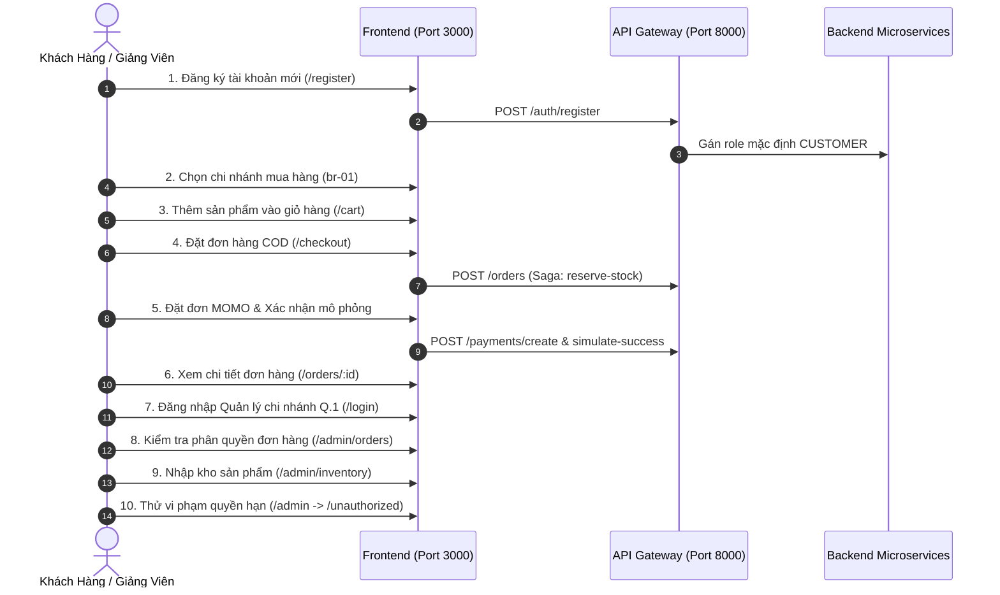

# KỊCH BẢN DEMO TIẾN ĐỘ ĐỒ ÁN CSM (THỜI LƯỢNG 5 PHÚT)

- **Đối tượng báo cáo:** GVHD ThS. Nguyễn Hữu Trung
- **Nhóm thực hiện:** Nhom04 (Hà Trường Giang, Nguyễn Khánh)
- **Mục tiêu:** Trực quan hoá luồng vận hành cốt lõi từ góc nhìn Khách hàng (O2O Shopping & Thanh toán mô phỏng) đến Quản trị viên/Quản lý chi nhánh (RBAC & Quản lý tồn kho đa chi nhánh).
- **Quy tắc an toàn:** Không in mật khẩu dạng văn bản thô (Plaintext). Mọi tài khoản sử dụng đều lấy từ dữ liệu seed chuẩn của hệ thống.

---

## TỔNG QUAN CÁC TÀI KHOẢN SEED & THÔNG TIN HỆ THỐNG

- **Frontend URL:** `http://localhost:3000`
- **Backend API Gateway URL:** `http://localhost:8000/api/v1`
- **Danh sách tài khoản kiểm thử chuẩn:**
  1. **Khách hàng (Customer Seed):** `customer@csm.vn` (Role: `CUSTOMER`, không gắn chi nhánh)
  2. **Quản lý chi nhánh Q.1 (Manager Seed):** `manager.q1@csm.vn` (Role: `BRANCH_MANAGER`, phụ trách chi nhánh `br-01`)
  3. **Quản trị viên toàn hệ thống (Admin Seed):** `admin@csm.vn` (Role: `ADMIN`, toàn quyền)

---

## KỊCH BẢN CHI TIẾT 10 BƯỚC DEMO (THEO TRÌNH TỰ)

---

### BƯỚC 1: ĐĂNG KÝ TÀI KHOẢN KHÁCH HÀNG MỚI
- **Mục tiêu:** Chứng minh hệ thống xác thực hoạt động thực tế, tự động ép role an toàn về `CUSTOMER`.
- **URL:** `http://localhost:3000/register`
- **Tài khoản sử dụng:** Nhập email mới linh động (ví dụ: `demo_user_<timestamp>@csm.vn`).
- **Thao tác:** Điền Họ tên, Email, Mật khẩu và bấm nút **"Đăng ký tài khoản"**.
- **Kết quả mong đợi:** Hệ thống hiển thị thông báo thành công, cấp Access Token và chuyển hướng về Trang chủ, trên thanh điều hướng xuất hiện tên người dùng.
- **Phương án dự phòng nếu bước này lỗi:** 
  - Đăng nhập trực tiếp bằng tài khoản khách hàng seed sẵn: `customer@csm.vn`.
  - Nếu Gateway chưa bật: Giao diện hiển thị form thông báo lỗi thân thiện nhờ `ErrorBoundary`.

---

### BƯỚC 2: CHỌN CHI NHÁNH MUA HÀNG (HAVERSINE & MULTI-BRANCH)
- **Mục tiêu:** Chứng minh kiến trúc bán lẻ đa chi nhánh (tồn kho gắn liền với từng cửa hàng vật lý).
- **URL:** `http://localhost:3000/`
- **Tài khoản sử dụng:** Khách hàng đã đăng nhập từ Bước 1.
- **Thao tác:** Nhấn vào nút chọn chi nhánh trên Header (hoặc Modal tự mở), chọn chi nhánh **"CSM Bến Nghé - Quận 1"** (ID: `br-01`).
- **Kết quả mong đợi:** Header cập nhật tên chi nhánh đã chọn `CSM Bến Nghé - Quận 1`. Toàn bộ dữ liệu tồn kho hiển thị tiếp theo sẽ lấy theo chi nhánh này.
- **Phương án dự phòng nếu bước này lỗi:** Hệ thống có cơ chế Fallback tự động chọn chi nhánh mặc định đầu tiên trong danh sách (`mockBranches[0]`) để không làm gián đoạn luồng mua hàng.

---

### BƯỚC 3: DUYỆT SẢN PHẨM VÀ THÊM VÀO GIỎ HÀNG
- **Mục tiêu:** Trình diễn giao diện hiện đại (Pastel Design System), xem chi tiết và kiểm tra tồn kho tức thời.
- **URL:** `http://localhost:3000/products` hoặc duyệt từ Trang chủ (`/`).
- **Tài khoản sử dụng:** Khách hàng hiện tại.
- **Thao tác:** 
  1. Chọn 1 sản phẩm còn hàng tại chi nhánh Bến Nghé (ví dụ: Nước suối hoặc Bánh mì).
  2. Bấm nút **"Thêm vào giỏ"**.
  3. Mở giỏ hàng tại `http://localhost:3000/cart`.
- **Kết quả mong đợi:** Badge giỏ hàng trên Header nhảy số (+1). Trong trang `/cart`, thanh tiến độ Freeship động tự tính số tiền còn thiếu để được miễn phí giao hàng.
- **Phương án dự phòng nếu bước này lỗi:** Dữ liệu giỏ hàng được đồng bộ an toàn qua `localStorage` bằng khối `try-catch`, nếu API tạm thời ngắt kết nối thì các thao tác tăng/giảm số lượng trong giỏ vẫn phản hồi mượt mà trên UI.

---

### BƯỚC 4: ĐẶT HÀNG THANH TOÁN KHI NHẬN HÀNG (COD) & KÍCH HOẠT SAGA
- **Mục tiêu:** Trình diễn luồng tạo đơn hàng, kích hoạt Saga giữ kho (`reserve-stock`) trong Inventory Service.
- **URL:** `http://localhost:3000/checkout`
- **Tài khoản sử dụng:** Khách hàng hiện tại.
- **Thao tác:** Điền địa chỉ giao hàng, chọn phương thức thanh toán **"Thanh toán khi nhận hàng (COD)"**, bấm nút **"Đặt hàng ngay"**.
- **Kết quả mong đợi:** 
  - Tạo đơn hàng thành công với trạng thái ban đầu là `PENDING`.
  - Backend gọi sang Inventory Service tăng `reserved_quantity` để giữ chỗ sản phẩm.
  - Tự động chuyển hướng sang trang chi tiết đơn hàng `/orders/:id`.
- **Phương án dự phòng nếu bước này lỗi:** Kiểm tra log console của `order-service`, nếu có lỗi kết nối kho thì Order Service tự động kích hoạt giao dịch bù trừ (Compensating Transaction) huỷ giữ chỗ.

---

### BƯỚC 5: ĐẶT HÀNG THANH TOÁN TRỰC TUYẾN MÔ PHỎNG (MOMO)
- **Mục tiêu:** Trình diễn luồng thanh toán mô phỏng an toàn có chữ ký token và xác nhận chuyển trạng thái.
- **URL:** `http://localhost:3000/checkout`
- **Tài khoản sử dụng:** Khách hàng hiện tại.
- **Thao tác:** 
  1. Thêm một món hàng khác vào giỏ, vào Checkout và chọn phương thức **"Ví điện tử MoMo"**.
  2. Bấm **"Tiến hành thanh toán"**.
  3. Hệ thống mở trang giao diện mô phỏng thanh toán MoMo của Payment Service (`/api/v1/payments/simulate-success/:orderId?token=...`).
  4. Bấm nút **"Xác nhận thanh toán thành công"**.
- **Kết quả mong đợi:** 
  - Trang mô phỏng gửi POST token hợp lệ, Payment Service cập nhật đơn hàng thành `CONFIRMED` -> `PAID` và gọi kho `confirm-deduct` để trừ tồn kho thực tế.
  - Hệ thống tự động chuyển hướng quay về Frontend tại `/orders/:id` với huy hiệu trạng thái xanh lá: **Đã thanh toán (PAID)**.
- **Phương án dự phòng nếu bước này lỗi:** Nếu cổng mô phỏng gặp sự cố mạng, có thể gọi trực tiếp endpoint POST `/api/v1/payments/simulate-success` kèm body `{ orderId, token }` qua Postman/curl.

---

### BƯỚC 6: XEM LỊCH SỬ ĐƠN HÀNG VÀ HUỶ ĐƠN HÀNG PENDING
- **Mục tiêu:** Chứng minh State Machine và quyền hạn khách hàng: chỉ được huỷ đơn khi còn ở trạng thái `PENDING`.
- **URL:** `http://localhost:3000/orders`
- **Tài khoản sử dụng:** Khách hàng hiện tại.
- **Thao tác:** 
  1. Truy cập danh sách đơn hàng cá nhân `/orders`, nhìn thấy cả 2 đơn vừa tạo (1 đơn `PAID`, 1 đơn `PENDING`).
  2. Mở đơn hàng `PENDING` (đơn COD ở Bước 4), bấm nút **"Huỷ đơn hàng"**.
- **Kết quả mong đợi:** Đơn hàng chuyển sang `CANCELLED`. Order Service gửi yêu cầu `release-stock` sang Inventory Service để trả lại số lượng tồn kho giữ chỗ.
- **Phương án dự phòng nếu bước này lỗi:** Nếu nút huỷ trên giao diện không phản hồi, xem trực tiếp trạng thái trong DB hoặc qua API `PATCH /api/v1/orders/:id/status` với body `{"status": "CANCELLED"}`.

---

### BƯỚC 7: ĐĂNG XUẤT VÀ ĐĂNG NHẬP VỚI TƯ CÁCH QUẢN LÝ CHI NHÁNH
- **Mục tiêu:** Kiểm tra cơ chế cấp phát JWT chứa thông tin vai trò `BRANCH_MANAGER` và mã chi nhánh `br-01`.
- **URL:** `http://localhost:3000/login`
- **Tài khoản sử dụng:** `manager.q1@csm.vn`
- **Thao tác:** Bấm Đăng xuất tài khoản khách, nhập email Quản lý chi nhánh Quận 1 và mật khẩu seed, bấm **"Đăng nhập"**.
- **Kết quả mong đợi:** Đăng nhập thành công, trên thanh menu xuất hiện thêm mục điều hướng **"Quản trị (Admin Portal)"** dẫn tới `/admin`.
- **Phương án dự phòng nếu bước này lỗi:** Sử dụng tài khoản quản trị tối cao `admin@csm.vn`.

---

### BƯỚC 8: QUẢN LÝ ĐƠN HÀNG PHÂN QUYỀN THEO CHI NHÁNH
- **Mục tiêu:** Chứng minh cơ chế cô lập dữ liệu (Data Isolation): Quản lý chi nhánh chỉ xem được đơn hàng thuộc chi nhánh mình.
- **URL:** `http://localhost:3000/admin/orders`
- **Tài khoản sử dụng:** `manager.q1@csm.vn`
- **Thao tác:** 
  1. Xem danh sách đơn hàng hiển thị tại bảng quản trị.
  2. Đối chiếu mã chi nhánh của các đơn hàng hiển thị (toàn bộ đều là `br-01` CSM Bến Nghé).
  3. Thử chuyển trạng thái 1 đơn hàng từ `CONFIRMED` sang `SHIPPED`.
- **Kết quả mong đợi:** Chỉ thấy đơn của chi nhánh `br-01`, không thấy đơn của chi nhánh Phú Mỹ Hưng (`br-02`). Chuyển trạng thái đơn thành công theo đúng State Machine.
- **Phương án dự phòng nếu bước này lỗi:** Dùng lệnh curl gửi kèm token của `manager.q1@csm.vn` gọi API `GET /api/v1/orders` để chứng minh Gateway và Order Service lọc dữ liệu tự động theo `x-branch-id`.

---

### BƯỚC 9: BÁO CÁO TỒN KHO VÀ NHẬP KHO TẠI CHI NHÁNH
- **Mục tiêu:** Trình diễn trực quan hoá số liệu Recharts và thao tác nhập kho (`add-stock`) kèm ghi nhật ký giao dịch.
- **URL:** `http://localhost:3000/admin/inventory`
- **Tài khoản sử dụng:** `manager.q1@csm.vn`
- **Thao tác:** 
  1. Xem biểu đồ Top 5 sản phẩm tồn thấp và cơ cấu trạng thái tồn kho (Đủ hàng / Cảnh báo / Hết hàng).
  2. Bấm nút **"Nhập kho"** tại góc trên bên phải.
  3. Chọn sản phẩm, nhập số lượng thêm (ví dụ: `50`), bấm **"Xác nhận nhập kho"**.
- **Kết quả mong đợi:** Số lượng tồn kho tức thời tăng lên 50, biểu đồ tự động cập nhật lại số liệu, bản ghi `stock_transactions` loại `IN` được lưu vào CSDL.
- **Phương án dự phòng nếu bước này lỗi:** Xem trực tiếp bảng tồn kho `stocks` trong CSDL `csm_inventory` để chứng minh câu lệnh SQL tăng số lượng thực tế.

---

### BƯỚC 10: KIỂM SOÁT AN TOÀN TRUY CẬP (ACCESS CONTROL VERIFICATION)
- **Mục tiêu:** Chứng minh hệ thống bảo vệ đa tầng (Router Guard ở FE và RolesGuard ở BE) ngăn chặn hoàn toàn việc leo thang đặc quyền.
- **URL:** `http://localhost:3000/admin`
- **Tài khoản sử dụng:** Đăng nhập lại tài khoản `customer@csm.vn` (hoặc mở tab ẩn danh đã đăng nhập khách hàng).
- **Thao tác:** Khách hàng cố tình gõ trực tiếp URL `/admin` hoặc `/admin/orders` lên thanh địa chỉ của trình duyệt.
- **Kết quả mong đợi:** Hệ thống chặn đứng truy cập ngay lập tức, chuyển hướng người dùng sang trang cảnh báo `http://localhost:3000/unauthorized` với thông báo: *"Bạn không có quyền truy cập khu vực quản trị này"*.
- **Phương án dự phòng nếu bước này lỗi:** Nếu FE không kịp chặn thì API Gateway và downstream service phía sau cũng sẽ trả về mã lỗi HTTP 403 Forbidden do `RolesGuard` bắt buộc quyền `STAFF`, `BRANCH_MANAGER` hoặc `ADMIN`.

---
*Tài liệu hướng dẫn kịch bản demo được lưu trữ tại: `docs/kich-ban-demo-5-phut.md`.*

