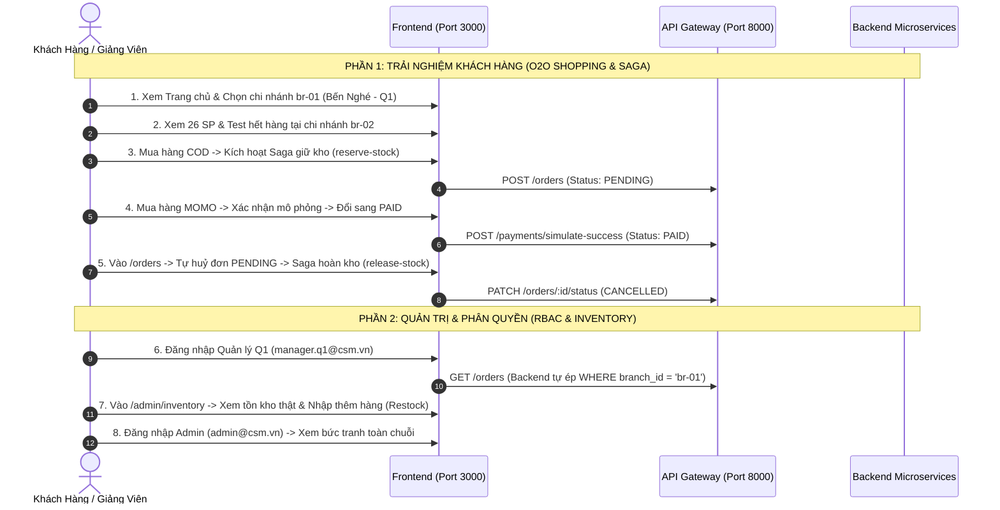

# KỊCH BẢN DEMO TIẾN ĐỘ ĐỒ ÁN CSM (THỜI LƯỢNG 5 - 7 PHÚT)

- **Đối tượng báo cáo:** GVHD ThS. Nguyễn Hữu Trung
- **Nhóm thực hiện:** Nhom04 (Hà Trường Giang, Nguyễn Khánh)
- **Mục tiêu:** Trực quan hoá luồng vận hành thực tế từ góc nhìn Khách hàng (O2O Shopping, Đa chi nhánh, Thanh toán mô phỏng & Saga) đến góc nhìn Quản trị viên / Quản lý chi nhánh (RBAC, Khoá chi nhánh, Quản trị kho hàng & State Machine).
- **Quy tắc bảo mật:** Không in mật khẩu dạng văn bản thô ra log. Mật khẩu demo đọc an toàn từ biến môi trường `SEED_PASSWORD`.

---

## 1. TỔNG QUAN HỆ THỐNG & TÀI KHOẢN DEMO

- **Giao diện Khách hàng & Quản trị (Frontend):** `http://localhost:3000`
- **Cổng kết nối trung tâm (API Gateway):** `http://localhost:8000/api/v1`
- **Tài liệu đặc tả API (Swagger UI):** `http://localhost:8000/docs`
- **Mật khẩu dùng chung cho toàn bộ tài khoản demo:** `Demo@123456`

### Danh sách tài khoản thực nghiệm chuẩn:
| STT | Email | Vai trò (Role) | Chi nhánh phụ trách | Mục đích demo |
| :---: | :--- | :--- | :---: | :--- |
| 1 | `customer1@csm.vn` | `CUSTOMER` | Không | Mua hàng, thanh toán COD, huỷ đơn PENDING |
| 2 | `customer2@csm.vn` | `CUSTOMER` | Không | Mua hàng thanh toán MOMO trực tuyến mô phỏng |
| 3 | `manager.q1@csm.vn` | `BRANCH_MANAGER` | `br-01` (Bến Nghé - Q1) | Demo phân quyền khoá đơn hàng theo chi nhánh Q1 |
| 4 | `manager.q2@csm.vn` | `BRANCH_MANAGER` | `br-02` (Phú Mỹ Hưng - Q7) | Đối chiếu phân quyền độc lập với chi nhánh Q1 |
| 5 | `admin@csm.vn` | `ADMIN` | Toàn hệ thống | Quản trị toàn quyền, xem toàn bộ chi nhánh và kho |

---

## 2. SƠ ĐỒ LUỒNG DEMO 8 BƯỚC

---

## 3. KỊCH BẢN CHI TIẾT 8 BƯỚC THỰC HIỆN

### Chuẩn bị trước khi bấm máy:
1. Mở cửa sổ **Trình duyệt thường (Tab 1)**: `http://localhost:3000` (để thao tác vai trò Khách hàng).
2. Mở cửa sổ **Trình duyệt ẩn danh (Tab 2)**: `http://localhost:3000/login` (để thao tác vai trò Quản lý chi nhánh).

---

### BƯỚC 1: GIỚI THIỆU TRANG CHỦ & KIẾN TRÚC O2O ĐA CHI NHÁNH
* **Thời lượng:** ~ 45 giây.
* **URL:** `http://localhost:3000/`
* **Thao tác:** 
  1. Bấm vào nút **"Chọn chi nhánh mua hàng"** trên Header.
  2. Chọn chi nhánh **"CSM Bến Nghé - Quận 1"** (`br-01`).
* **Lời nói với thầy:** 
  > *"Hệ thống CSM áp dụng mô hình O2O (Online-to-Offline) cho chuỗi cửa hàng tiện lợi. Mỗi cửa hàng vật lý có toạ độ GPS thực tế ở TP.HCM. Tồn kho và xử lý đơn hàng sẽ gắn chặt với chi nhánh mà khách hàng lựa chọn."*
* **Kết quả mong đợi:** Header hiển thị tên chi nhánh đã chọn: `CSM Bến Nghé - Quận 1`.

---

### BƯỚC 2: XEM 26 SẢN PHẨM & DEMO KHÁC BIỆT TỒN KHO THEO CHI NHÁNH
* **Thời lượng:** ~ 1 phút.
* **URL:** `http://localhost:3000/products`
* **Thao tác:**
  1. Cuộn trang giới thiệu: Toàn bộ **26 sản phẩm** thuộc 5 danh mục (Đồ uống, Bánh kẹo & Snack, Mì & Thức ăn nhanh, Sữa, Đồ dùng cá nhân) hiển thị đầy đủ với hình ảnh nhận diện danh mục, giá bán chuẩn VNĐ.
  2. **Thao tác điểm nhấn:** Đổi chi nhánh sang **"CSM Phú Mỹ Hưng - Quận 7" (`br-02`)**:
     * Tìm món **"Cơm Nắm Onigiri Cá Hồi Mayonnaise"**: Hệ thống hiển thị huy hiệu **"Hết hàng" (0 tồn)**, nút Thêm giỏ bị khóa.
     * Đổi lại chi nhánh **"CSM Bến Nghé - Quận 1" (`br-01`)**: Món này lập tức **còn hàng (50 cái)** và đặt mua bình thường.
* **Lời nói với thầy:** 
  > *"Cùng một mã sản phẩm (Master Product), nhưng số lượng tồn kho được quản lý độc lập tại từng database/microservice kho của chi nhánh đó."*

---

### BƯỚC 3: ĐẶT ĐƠN COD & KÍCH HOẠT SAGA GIỮ HÀNG (`reserve-stock`)
* **Thời lượng:** ~ 45 giây.
* **URL:** `http://localhost:3000/checkout`
* **Tài khoản sử dụng:** `customer1@csm.vn` | Mật khẩu: `Demo@123456`
* **Thao tác:**
  1. Chọn món **"Trà Sữa Trân Châu CSM"** (chi nhánh Q1 hiện chỉ có đúng 2 cái) -> Bấm **Thêm vào giỏ**.
  2. Vào giỏ hàng [http://localhost:3000/cart](http://localhost:3000/cart) -> Bấm **Tiến hành thanh toán**.
  3. Chọn phương thức **"Thanh toán khi nhận hàng (COD)"** -> Bấm nút **"Đặt hàng ngay"**.
* **Lời nói với thầy:** 
  > *"Khi bấm Đặt hàng, Order Service gọi sang Inventory Service thực hiện Bước 1 của Saga là `reserve-stock` (giữ hàng tạm thời bằng khoá bi quan pessimistic_write lock). Đơn hàng được tạo thành công ở trạng thái `PENDING`."*
* **Kết quả mong đợi:** Đơn hàng tạo thành công, chuyển hướng đến trang xem chi tiết đơn với mã đơn dạng `#...` và trạng thái `PENDING`.

---

### BƯỚC 4: ĐẶT ĐƠN MOMO & THANH TOÁN MÔ PHỎNG TRỰC TUYẾN
* **Thời lượng:** ~ 45 giây.
* **URL:** `http://localhost:3000/checkout`
* **Thao tác:**
  1. Chọn sản phẩm bất kỳ -> Vào trang thanh toán.
  2. Chọn phương thức **"MOMO"** -> Bấm **Đặt hàng ngay**.
  3. Hệ thống tự động chuyển hướng sang giao diện **Mô phỏng Cổng thanh toán CSM**.
  4. Bấm nút **"Xác nhận thanh toán mô phỏng"**.
* **Lời nói với thầy:** 
  > *"Cổng thanh toán sinh JWT token có hạn 10 phút mã hoá kèm orderId. Khi khách bấm xác nhận, hệ thống gọi API `simulate-success` chuyển đơn hàng sang `PAID` và tự động kích hoạt Bước 2 của Saga: `confirm-deduct` để trừ hàng thực tế khỏi kho."*
* **Kết quả mong đợi:** Sau 1.5 giây, trang tự động chuyển hướng về chi tiết đơn hàng với trạng thái `PAID` màu xanh lá.

---

### BƯỚC 5: LỊCH SỬ ĐƠN & KHÁCH TỰ HUỶ ĐƠN PENDING (SAGA BÙ TRỪ)
* **Thời lượng:** ~ 45 giây.
* **URL:** `http://localhost:3000/orders`
* **Thao tác:**
  1. Vào danh sách đơn hàng cá nhân: thấy đầy đủ các đơn đã đặt.
  2. Tìm đơn hàng COD vừa tạo ở Bước 3 (trạng thái `PENDING`).
  3. Bấm nút **"Huỷ đơn"**.
* **Lời nói với thầy:** 
  > *"Theo thiết kế State Machine, khách hàng CHỈ được quyền huỷ đơn khi đơn còn `PENDING`. Khi khách huỷ, hệ thống kích hoạt Giao dịch bù trừ (Compensating Transaction) gọi sang Inventory Service thực hiện `release-stock`, giải phóng số lượng giữ chỗ và hoàn trả tồn kho."*
* **Kết quả mong đợi:** Trạng thái đơn chuyển sang `CANCELLED`. Nút huỷ đơn biến mất (trạng thái kết thúc).

---

### BƯỚC 6: ĐĂNG NHẬP QUẢN LÝ Q1 -> KIỂM TRA KHOÁ CHI NHÁNH
*(Chuyển sang cửa sổ Trình duyệt ẩn danh Tab 2)*
* **Thời lượng:** ~ 1 phút.
* **URL:** `http://localhost:3000/admin/orders`
* **Tài khoản sử dụng:** `manager.q1@csm.vn` | Mật khẩu: `Demo@123456`
* **Thao tác:**
  1. Đăng nhập thành công với vai trò Quản lý chi nhánh Bến Nghé Q1.
  2. Xem danh sách đơn hàng quản trị:
* **Chỉ cho thầy thấy:** 
  * Cột chi nhánh: **100% các đơn hiển thị đều có mã `br-01`**. Hoàn toàn không nhìn thấy bất kỳ đơn hàng nào của chi nhánh `br-02` (Q7).
  * Thử chuyển trạng thái 1 đơn từ `PENDING` sang `CONFIRMED` bằng nút chuyển nhanh.
* **Lời nói với thầy:** 
  > *"Tại API Gateway và Order Controller, hệ thống tự động trích xuất `branch_id` từ JWT Claims của Quản lý và ép cứng câu truy vấn `WHERE branch_id = :userBranch`. Client không thể can thiệp URL để xem trộm đơn của chi nhánh khác."*

---

### BƯỚC 7: QUẢN TRỊ KHO (`/admin/inventory`) & NHẬP THÊM HÀNG
* **Thời lượng:** ~ 45 giây.
* **URL:** `http://localhost:3000/admin/inventory`
* **Thao tác:**
  1. Chỉ cho thầy thấy bảng tồn kho:
     * Hiển thị **100% tên sản phẩm thật** ("Trà Sữa Trân Châu CSM", "Cà Phê Sữa Đá Sài Gòn", ...), không có mã lỗi hay placeholder thô.
     * Hiển thị rõ: Số lượng tồn kho, Số lượng đang giữ (`reserved`), và Số lượng có thể bán (`available`).
  2. Bấm nút **"Nhập kho" (Restock)** tại 1 sản phẩm -> Nhập thêm 20 cái -> Bấm Lưu.
* **Kết quả mong đợi:** Tồn kho tăng ngay lập tức và ghi nhận giao dịch nhập kho loại `IN` trong database.

---

### BƯỚC 8: TỔNG KẾT VỚI THẦY
* **Thời lượng:** ~ 30 giây.
* **Lời kết:**
  > *"Dạ thưa thầy, nhóm đã hoàn thành toàn diện:
  > 1. Kiến trúc Microservices gồm 8 dịch vụ độc lập kết nối qua API Gateway.
  > 2. Quản lý nhất quán dữ liệu phân tán bằng Saga Pattern (giữ kho, trừ kho, hoàn kho bù trừ).
  > 3. Phân quyền chặt chẽ theo chi nhánh vật lý và State Machine nghiêm ngặt cho vòng đời đơn hàng.
  > 4. Bộ kiểm thử tự động đạt 121/121 ca E2E trên stack thực tế."*

---

## 4. BẢNG PHƯƠNG ÁN DỰ PHÒNG NẾU GẶP SỰ CỐ KHI DEMO

| Sự cố phát sinh | Nguyên nhân có thể | Phương án xử lý ngay |
| :--- | :--- | :--- |
| Trình duyệt không tải được trang sản phẩm | Do cache trình duyệt cũ | Nhấn `Ctrl + F5` để xoá cache nạp lại bundle mới nhất. |
| Đăng nhập báo sai mật khẩu | Nhập nhầm ký tự hoa thường | Mật khẩu chuẩn toàn bộ hệ thống là: `Demo@123456`. |
| Đặt hàng báo lỗi không đủ tồn kho | Do đã mua hết sạch món đó | Chọn món khác hoặc đăng nhập Admin vào `/admin/inventory` bấm nút Nhập kho 50 cái. |
| Muốn reset làm mới dữ liệu demo ngay | Do đã tạo quá nhiều đơn thử nghiệm | Mở PowerShell chạy lệnh: `npm run seed:demo -- --reset -y && npm run seed:demo`. |

---

## 5. BỘ CÂU HỎI THƯỜNG GẶP CỦA GIẢNG VIÊN VÀ CÂU TRẢ LỜI CHUẨN XÁC

### Câu 1: Tại sao nhóm dùng Saga Pattern mà không dùng Distributed Transaction (2PC)?
* **Trả lời:** Giao thức 2PC (Two-Phase Commit) yêu cầu giữ khoá tài nguyên (Lock) xuyên suốt mạng phân tán, gây tắc nghẽn và giảm hiệu năng nghiêm trọng khi nhiều người cùng đặt hàng. Nhóm áp dụng mô hình **Saga dựa trên Choreography/Orchestration qua REST**:
  - Bước 1: Giữ kho tạm thời (`reserve-stock`).
  - Bước 2: Lưu đơn `PENDING` và xử lý thanh toán.
  - Bước 3: Xác nhận trừ kho thật (`confirm-deduct`) hoặc kích hoạt giao dịch bù trừ hoàn kho (`release-stock`) nếu có lỗi/huỷ đơn.
* **File minh chứng:** [`apps/order-service/src/order.controller.ts`](file:///E:/TLCN/CSM-BE/apps/order-service/src/order.controller.ts#L82-L138).

### Câu 2: Làm sao giải quyết vấn đề Race Condition khi 2 người cùng đặt 1 sản phẩm cuối cùng?
* **Trả lời:** Tại Inventory Service, nhóm sử dụng khoá bi quan cấp cơ sở dữ liệu: `lock: { mode: 'pessimistic_write' }` bên trong Database Transaction (`QueryRunner`). Transaction nào đến trước sẽ giữ kho và giảm tồn khả dụng, transaction thứ hai sẽ nhận thông báo lỗi không đủ tồn kho ngay lập tức.
* **File minh chứng:** [`apps/inventory-service/src/inventory.controller.ts`](file:///E:/TLCN/CSM-BE/apps/inventory-service/src/inventory.controller.ts#L93-L96).

### Câu 3: Làm thế nào đảm bảo Quản lý chi nhánh không xem hoặc sửa được đơn của chi nhánh khác?
* **Trả lời:** Nhóm kiểm soát 2 lớp:
  1. Lớp xác thực tại API Gateway: Giải mã JWT token để lấy `role` và `branch_id`.
  2. Lớp nghiệp vụ tại Order Service: Nếu `role === 'BRANCH_MANAGER'`, câu lệnh TypeORM QueryBuilder tự động ép cứng điều kiện `qb.andWhere('order.branch_id = :userBranch', { userBranch: userBranchId })`, bỏ qua bất kỳ tham số lọc nào mà client truyền lên.
* **File minh chứng:** [`apps/order-service/src/order.controller.ts`](file:///E:/TLCN/CSM-BE/apps/order-service/src/order.controller.ts#L366-L372).

### Câu 4: Cổng thanh toán mô phỏng được bảo mật như thế nào?
* **Trả lời:** Không thể can thiệp đổi trạng thái tuỳ tiện vì:
  1. Cờ mô phỏng `PAYMENT_SIMULATION` chỉ đọc từ biến môi trường máy chủ.
  2. Đường dẫn thanh toán chứa JWT token được ký bởi `PAYMENT_SIMULATION_SECRET`, mã hoá kèm `orderId` và chỉ có hiệu lực 10 phút.
  3. API `POST /payments/simulate-success` kiểm tra chữ ký token và xác thực token phải khớp chính xác với `orderId` trước khi chuyển trạng thái đơn.
* **File minh chứng:** [`apps/payment-service/src/payment.controller.ts`](file:///E:/TLCN/CSM-BE/apps/payment-service/src/payment.controller.ts#L40-L57).
